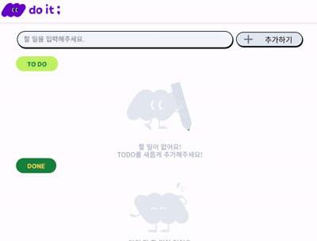
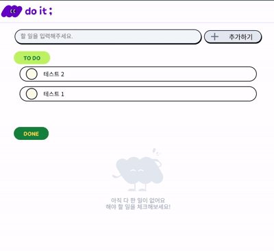
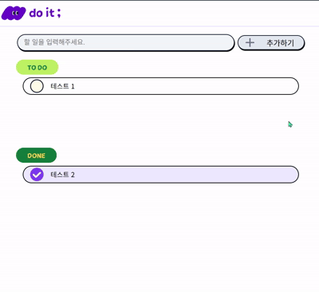
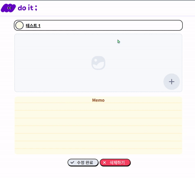
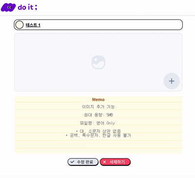
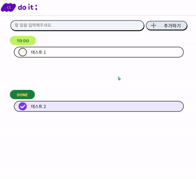
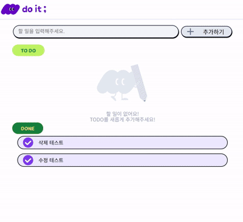

### To Do List

할 일 목록을 관리하는 To Do 서비스

**📆 작업 기간** <br/>
**`2026.11.10 ~ 2026.11.15`**

---

### 🛠 Use Stacks
``` text
Language: TypeScript
Library & Framework: React, Next.js
Style: css-modules, styled-components
Forms: React Hook Form
Publish: Vercel
```

---

### 사용 방법

#### 할 일 추가 



화면 상단, 할 일 입력 창에 할 일을 입력하고 <br/>
**`[+ 추가하기]`** 버튼을 클릭하거나, Enter 키를 누르면 할 일이 추가됩니다. <br/>
새로 추가된 할 일은 To Do 탭에서 확인 가능합니다.

---
#### 할 일 상태 전환




**`[To Do]`** 탭에 새로 추가된 할 일 좌측의 체크 박스를 클릭하면 <br/>
할 일을 완료할 수 있습니다. 완료된 일은 **`[Done]`** 탭에서 확인 가능합니다.

**`[Done]`** 탭의 완료된 일 좌측의 체크 박스를 클릭하면 <br/>
다시 진행 중인 상태, 할 일로 복구할 수 있습니다.

---
#### 할 일 상세 확인



**`[To Do / Done]`** 상관 없이, 할 일 아이템 클릭하면 <br/>
할 일 상세 페이지로 이동할 수 있습니다. <br/>
( **`'/' → '/items/[itemId]'`** ) <br/>
(단, 할 일 아이템 좌측 체크 박스는 제외) <br/>



할 일 상세 페이지에선 할 일 명을 변경하는 것이 가능하며 <br/>
<b>`'/(home)'`</b>과 마찬가지로 체크 박스를 클릭하여 할 일 완료 여부를 <br/>
변경하는 것도 가능합니다. ( **`To Do` ↔ `Done`** )



중앙의 이미지 탭의 **`[+]`** 버튼을 클릭하면 이미지를 추가할 수 있으며

``` text
파일 명은 영어만 가능 (대, 소문자 상관 없음)
(한글, 특수문자, 공백 등 사용 불가)
파일 최대 용량은 5MB 입니다.
```

Memo 탭을 통해, 해당 할 일과 관련된 메모를 추가할 수 있습니다.

---

#### 할 일 수정 및 삭제

**할 일 수정**



할 일 상세 페이지에서 수정할 내용들을 입력하고 <br/>
(이름 변경, 완료된 일 전환, 이미지 추가, 메모 추가) <br/>

하단의 **`[수정 완료]`** 버튼을 클릭하면, 할 일의 수정이 가능합니다.

**할 일 삭제**



할 일 상세 페이지에서 할 일의 삭제도 할 수 있습니다. <br/>
하단의 **`[삭제하기]`** 버튼을 클릭 시 정말로 삭제할 것인지 묻는 
alert 창이 나오고 <br/>
해당 alert 창에서 **`[확인]`** 버튼을 클릭해서 <br/>
해당 할 일을 삭제할 수 있습니다. <br/>
(할 일의 삭제가 완료되면 자동으로 `'/(home)'`으로 이동합니다.)

---